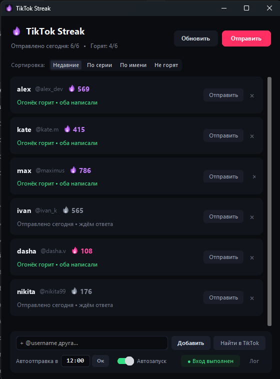

# 🔥 TikTok Streak Keeper (Auto Streak Bot for Windows)

**TikTok Streak Keeper** — десктопное приложение с иконкой в системном трее для автоматического поддержания огоньков (streaks) в TikTok на Windows. Раз в сутки само проверяет выбранных друзей и отправляет сообщение (`🔥`), если сегодня ты им ещё не писал.

> **TikTok Auto Streak Bot for Windows** — keep your TikTok streaks alive automatically in the background with a clean dark GUI, system tray icon, and standalone `.exe` (no Python required).

<p align="center">
  
</p>

## Возможности / Features

- **Готовый `.exe` без установки Python** — скачай один файл и запускай двойным кликом (работает через встроенный в Windows Microsoft Edge).
- **Минималистичный интерфейс и иконка в системном трее** — постоянно висит в трее возле часов:
  - при **наведении мыши** на иконку показывает сводку за сегодня (`6/6 отправлено`, `горят: 4/6`);
  - по **правому клику** открывает быстрое меню со статусом огонька каждого друга;
  - по **левому клику** открывает тёмное окно со списком друзей, сортировкой (`Недавние`, `По серии`, `По имени`, `Не горят`), временем автоотправки и статусом входа.
- **Цветные огоньки по длине серии (как в TikTok)** — серый огонёк, если сегодня ещё не горит с обеих сторон, и цветной по уровню серии (`200+` фиолетовый, `100–199` розовый, `30–99` красный, `<30` оранжевый), когда оба написали.
- **Работает полностью в фоне** — запускается вместе с Windows без консоли и без видимых окон браузера.
- **Сам находит огоньки** — сканирует чаты на `tiktok.com/messages`, определяет друзей с активными сериями и добавляет их в список.
- **Защита от дублей** — проверяет и локальную базу (`state.json`), и реальную историю чата в TikTok (если ты уже написал человеку с телефона, второй раз не отправит).
- **Умная пауза на капче** — если TikTok попросит пройти проверку или заново войти в аккаунт, скрипт выведет окно браузера на экран, подождёт решения и продолжит работу.

---

## Быстрая установка / Quick Start

### Способ 1: Скачать готовый `.exe` (рекомендуется)
1. Скачай **`TikTokStreakKeeper.exe`** со страницы **[Releases](https://github.com/frizonov/tiktok-streak-keeper/releases/latest)**.
2. Положи его в отдельную папку (например, на Рабочем столе) и запусти двойным кликом.

*(Либо скачай и запусти одной командой в PowerShell):*
```powershell
$dir = "$HOME\Desktop\TikTokStreakKeeper"; New-Item -ItemType Directory -Path $dir -Force | Out-Null; Invoke-WebRequest "https://github.com/frizonov/tiktok-streak-keeper/releases/latest/download/TikTokStreakKeeper.exe" -OutFile "$dir\TikTokStreakKeeper.exe"; Start-Process "$dir\TikTokStreakKeeper.exe"
```

<details>
<summary>Способ 2: Запуск из исходников (Python / Git)</summary>

1. Установи Python 3.10+:
   ```powershell
   winget install -e --id Python.Python.3.12 --scope machine
   ```
2. Скачай и запусти:
   ```powershell
   git clone https://github.com/frizonov/tiktok-streak-keeper.git
   cd tiktok-streak-keeper
   .\start.bat
   ```
3. Собрать собственный `.exe`:
   ```powershell
   powershell -ExecutionPolicy Bypass -File .\build_exe.ps1
   ```
</details>

---

## Первая настройка

1. Запусти **`TikTokStreakKeeper.exe`** — откроется окно **TikTok Streak** и появится иконка огонька в трее возле часов.
2. Нажми внизу **`● Войти в TikTok`** — откроется браузер. Войди в свой аккаунт TikTok и закрой окно браузера (кнопка станет зелёной: `● Вход выполнен`).
3. Нажми **`Найти в TikTok`** — программа просканирует твои чаты и предложит отметить друзей с огоньками (или добавь ники вручную через `+ @username`).
4. Нажми **`Отправить`** (или включи переключатель **`Автозапуск`** и задай время, например `12:00`).
5. Закрой окно на крестик — приложение свернётся в системный трей и будет работать в фоне.

---

## FAQ / Поисковые теги

- **Как работает бот для огоньков в TikTok?**
  Открывает `tiktok.com/messages` в фоновом режиме через реальный браузер с твоей сохранённой сессией и отправляет `🔥` раз в день тем друзьям, кому сегодня ещё не было отправлено сообщение.
- **Нужно ли держать ПК включённым ровно в 12:00?**
  Нет. Если компьютер был выключен в заданное время, после включения фоновый сервис увидит, что время уже прошло, и тихо отправит огоньки.

---

## Лицензия

[MIT](LICENSE)
